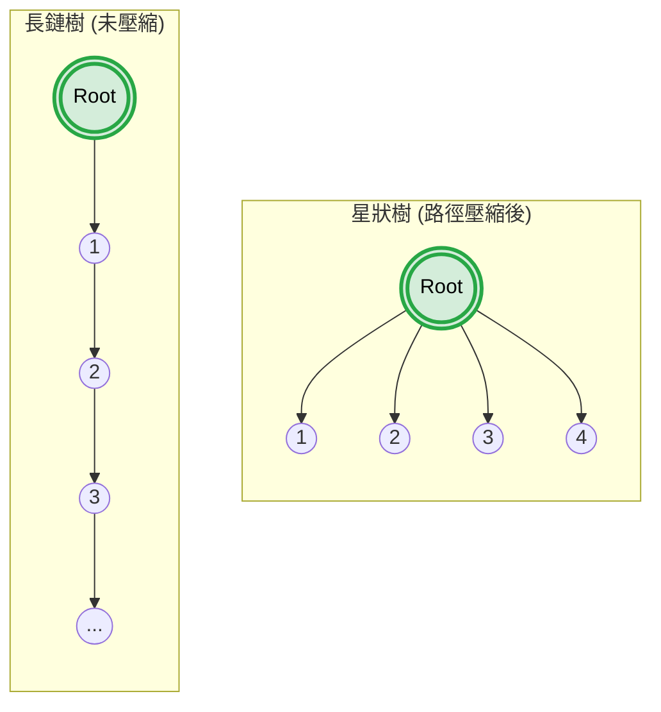
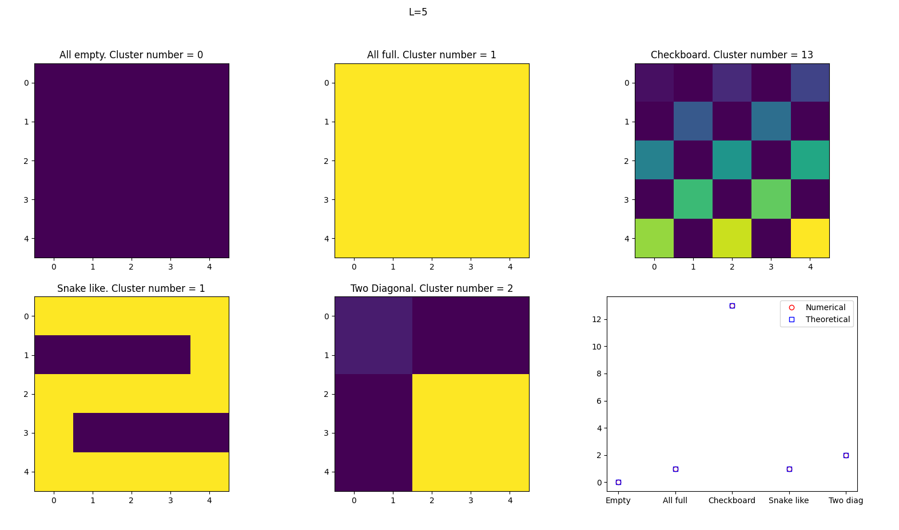

# Problem 0: Toolkit

In the practice problem,  we are required to design a function for union and find the set of a specific node. Here, the node is the lattice site, and two nodes are union together when they are connected. 

To do this, an intuitive way is to connect two adjacent point one by one (See 長鏈樹). However, in this case, node 3 only know it connects to node 2, without knowing that it connects to the node 1. 
This will cause the cluster finding become inefficient. 

Another way to obtain the cluster that each node belongs to, is to assign each node with the common root that they are assigned. This will allow all nodes to know which group they are belonging to, avoiding the issue of finding the group. 





Overall speaking, the common root finding can be achieved through a union set function and a find set function. 
Considering now that you have five sites that have interactions. The interaction group is [1, 2], [2, 3], [4, 5]/ Based on this interaction, you would like to group [1, 2, 3] together, and [4, 5] together.
Initially, we assign the parent index for each node as their own index,  [1, 2, 3, 4, 5]. Then, for the interaction [1, 2], we first check their parent index. When they are different, we merge their parent index together. To avoid ambiguity, we always use larger cluster index as the parent index. For the case of two clusters with the same size merge, we choose the former one. In our example, the first set of parent set for [1, 2] is [1, 2]. Hence, we change parent index for 2 to 1, and add the size of index 1 by 1. Then, we check the parent index for interaction [2, 3]. This time, when we call find_set in the union_sets, it will first recall that the parent of 2 is 1. However, since 2 is not equal to 1, the recursive structure in find_set will call itself again with argument find_set(1), which is now equals to the index itself (1=1). Hence, the find_set allow us to find the ground root of a node.
Hence, the parent index for the interaction is [1, 3], with cluster size 2 for index 1 and 1 for index 3. Hence, this time we must change parent index to be 3. As a result, the parent index of [1, 2, 3] turns out to be [1, 1, 1]. By this, we are able to find the union of the system. 


```python
def find_set(self, v):
    if v == self.parent[v]:
        return v
    else:
        self.parent[v] = self.find_set(self.parent[v]) 
        return self.find_set(self.parent[v])
             

def union_sets(self, a, b):
    a = self.find_set(a)
    b = self.find_set(b)
    if a != b:
        if self.size[a] < self.size[b]:
            a, b = b, a
        self.parent[b] = a
        self.size[a] += self.size[b];
```


The final resulting figure in problem 0 is:
