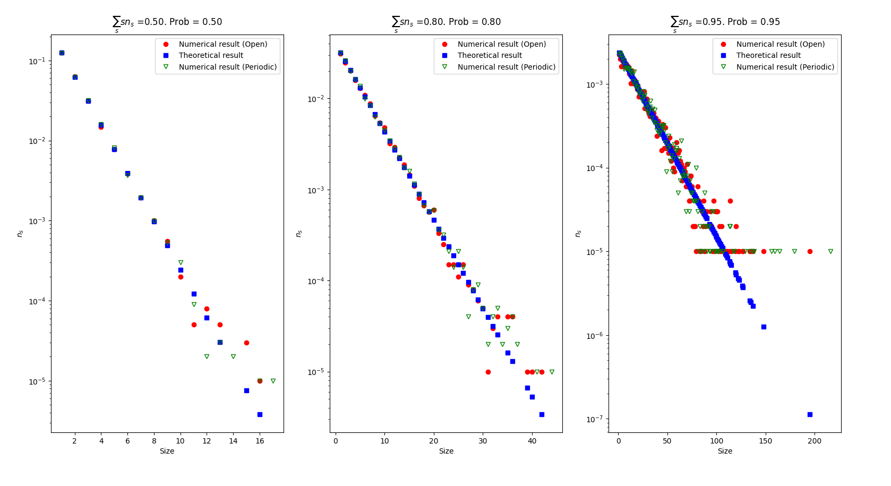
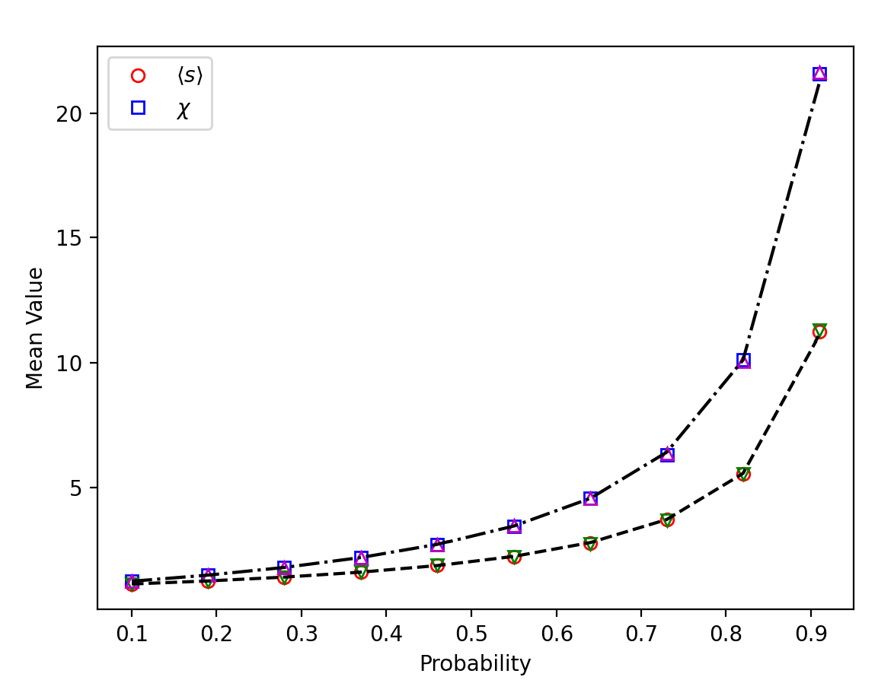
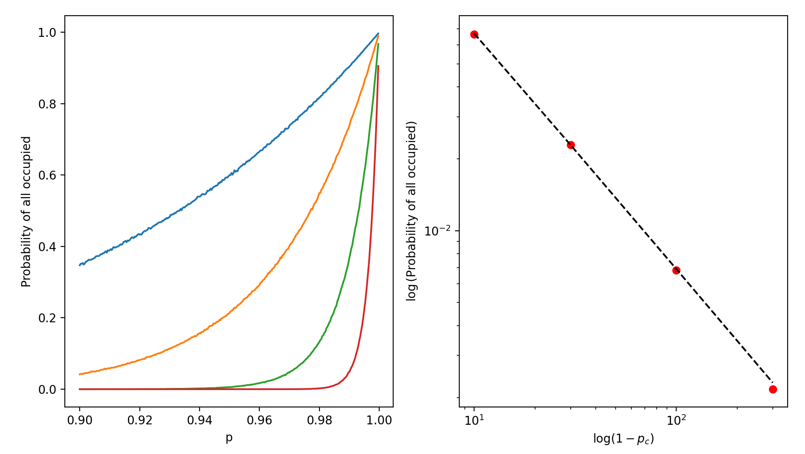
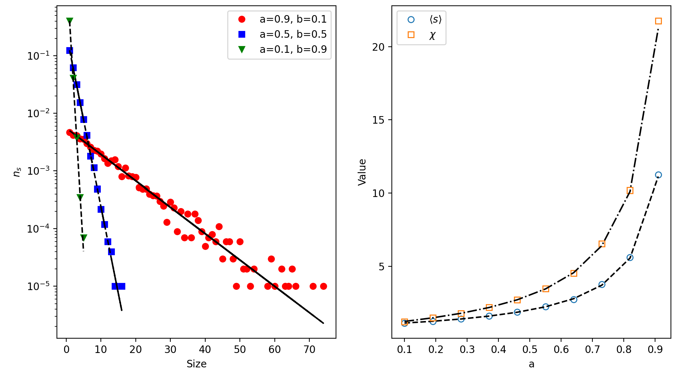

# Problem A: Toolkit The one-dimensional chain
## Cluster-size distribution
Simulate a chain of $L$ sites, each occupied with probability $p$.

(a) Measure $n_s$, the number of clusters of size $s$ *per site*, for $p=0.5,0.8,0.95$ and $L=10^5$, and plot it on a semi-log axis against $(1-p)^2p^s$.


(b) Do this once with open and once with periodic boundaries. Where do they differ, and why does the difference grow as $p\to1$?

(c) Verify numerically that $\sum_s s\,n_s=p$.
\end{enumerate}
\checkpt At $p=0.5$, $n_1=0.125$ and $n_2=0.0625$.


<details>
<summary><b>Solution</b></summary>

The main purpose of this problem is to familiar with basic properties of 1D site percolation. 
It is crucial to note that, when we calculate the probability, we divide the number of cluster count by the total lattice number, rather the total number of cluster. The main reason is that $n_s$ is defined as the probability of picking up an occupied lattice which belongs to a cluster with size s. The difference between these two can be calculated. As a cluster must accompanied with one empty site at the left of an occupied site, counting cluster number is the same as counting the number of one empty site at the left of an occupied site, which is $Lp(1-p)$. 
If you divide all_number by the number of cluster, you are calculating the probability of having a cluster with size s when you pick up a cluster. 

```python
all_size = np.array(list(cluster_stat.keys()))
all_number = np.array(list(cluster_stat.values()))
all_number_prob = all_number/L
```

The results of all questions are summarized in the following figure. One can observe that the difference between period BC and open BC is nuance. The main reason is that the only difference between open and period BC is at most one cluster. Hence, when you have multiple clusters, having one cluster number difference is commonly negligible. As a result, we can not observe any clear difference between open and periodic BC, unless the number of cluster is small. 




</details>


## Two kinds of mean cluster size

This problem makes the distinction between cluster-weighted and site-weighted averages concrete.

(a) From your $n_s$, compute the cluster average $\langle s\rangle_{\text{cluster}}=\sum s\,n_s/\sum n_s$ and the site average $\chi=\sum s^2n_s/\sum s\,n_s$.

(b) Estimate $\chi$ a second, independent way: pick $10^4$ occupied sites uniformly at random and average the size of the cluster each belongs to. Do the two estimates agree within error bars?

(c) Plot both averages against $p$ together with $1/(1-p)$ and $(1+p)/(1-p)$.

Checkpoint: At $p=0.5$: $\langle s\rangle_{\text{cluster}}=2$, $\chi=3$. At $p=0.9$: $\langle s\rangle_{\text{cluster}}=10$, $\chi=19$.

*Think* Repeat (b) but pick a random *cluster* first and then a random site in it. Which average do you get, and why?

<details>
<summary><b>Solution</b></summary>

The purpose of this question is to understand two different method in calculating the average. As we can get in part (b), if we condition on picking up **occupied site**, then the average size that site belongs to will be $\chi$. This is because a large cluster has a higher chance to be picked up, and the probability propotional to $sn_s$. In contrast, if we pick up a cluster first, then the average size is $\langle s\rangle$. 

Finally, to calculate the value of summation, one can notice that
$d/dp(\sum p^s) = \sum sp^{s-1}$, and thus $\sum sp^{s} = p d/dp(\sum p^s) $. With this, one can calculate $\langle s\rangle = (1-p)^{-1}$ and $\chi = (1+p)/(1-p)$.



</details>


## The threshold of a finite chain

In 1D, $p_c=1$ only for an infinite chain. For a chain of length $L$ with open boundaries, spanning means all $L$ sites are occupied.

(a) Measure the spanning probability $\Pi_L(p)$ for $L=10,30,100,300$. Overlay the curves.

(b) Define an effective threshold $p_c(L)$ by $\Pi_L=1/2$. Plot $1-p_c(L)$ against $L$ on log--log axes and fit a power law.

(c) Compare with what you can work out on paper for $\Pi_L(p)$.

*Check point* $p_c(10)\approx0.933$, $p_c(100)\approx0.9931$; the log--log slope is $-1$.

*Think* The correlation length of the 1D chain is $\xi=-1/\ln p$. Show that $p_c(L)$ is where $\xi\sim L$. This is the simplest example of finite-size scaling.

<details>
<summary><b>Solution</b></summary>
The purpose of this problem is to show that, in a finite system, percolation in 1D can happen even when L is not infinite. The probability of having all sites to be occupied is $p^L$. We can measure the spanning probability, which is the probability of having all sites occupied. One can even relate this with the scaling of the correlation length. 



</details>


## A correlated chain (a first non-ideal case)

Real binding sites are rarely independent. Generate a chain as a two-state Markov process: a site is occupied with probability $a$ if its left neighbour is occupied, and with probability $b$ if its left neighbour is empty.

(a) Before simulating, predict on paper the overall occupied fraction and the distribution of cluster sizes. (What is the probability that a cluster that has reached size $s$ grows to $s+1$?)

(b) Simulate for $(a,b)=(0.9,0.1)$, $(0.5,0.5)$ and $(0.1,0.9)$. Compare $n_s$ and $\chi$ with your predictions and with an uncorrelated chain of the *same* occupied fraction.

*Check point* $(a,b)=(0.5,0.5)$ must reduce to the uncorrelated chain with $p=0.5$.
*Think* Positive correlations ($a>b$) make large clusters much more likely at fixed density. Which biological mechanisms (cooperative binding, nucleation) produce $a>b$?


<details>
<summary><b>Solution</b></summary>

To solve this question, we can assume that the probability of finding an occupied site is $\pi$. This is steady state meaning that the next site is also occupied with probability $\pi$. By definition, the next site will be occupied with the probability $a\pi +b(1-\pi)$. Solving this to be equal to $\pi$, we can get $\pi = b/(1-a+b)$.
As a result, the probability of creating a cluster with size $s$ will turn out to be 
$n_s = (1-\pi)ba^{s-1}(1-a)$. 

With the similar calculation, one can prove that $\langle s \rangle = (1-a)^{-1}$ and $\chi = (1+a)/(1-a)$.

All the results are shown in the following figure. 




</details>


